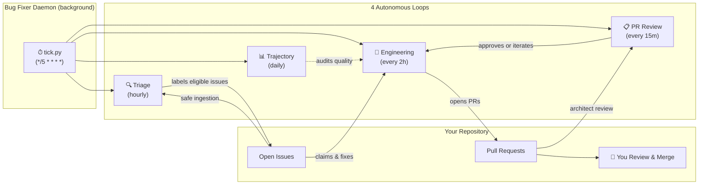

# Bug-Fixer


-orange.svg)


Bug-Fixer is an autonomous agent plugin for [Google Antigravity](https://github.com/google/antigravity) that works like a guard-railed engineer and team-lead running in the background. It triages issues, implements surgical fixes, runs your test suite, reviews the code and, when satisfied, and opens clean pull requests — all without touching your working tree or auto-merging anything. You stay in control; it handles the backlog.

---

## Why Bug-Fixer?

- **Fully autonomous, never unsupervised.** Four coordinated loops handle triage → fix → review → quality audit. Every change lands as a PR for human review. Nothing merges without you.

- **Security-first architecture.** A multi-layered gate system (PreToolUse hooks, safe ingestion, egress leak scanning, cryptographic receipts) defends against prompt injection, secret leakage, and model drift — even from malicious issue content. Optionally integrates with [Google Cloud Model Armor](https://cloud.google.com/security/products/model-armor) and [BetterLeaks](https://github.com/zricethezav/gitleaks).

- **Zero interference with your work.** An active-PR exclusion zone detects files you're already working on and avoids them. Fixes run in ephemeral git worktrees, completely isolated from your working tree.

- **Works with any project.** Configurable test commands, lint commands, and protected file lists. If your project has a test suite, Bug-Fixer can work with it — whether it's `pytest`, `npm test`, `pio test`, or anything else.

- **Multi-repo from day one.** Enroll as many repositories as you need. Each gets its own config, state, and scheduled loops from a single daemon installation.

---

## How It Works

Bug-Fixer runs as a background daemon plugin inside Antigravity. A single heartbeat sidecar per enrolled repository ticks every 5 minutes and delegates work to four specialised loops:



1. **Triage** classifies new issues — routing automatable bugs to engineering and flagging complex ones for human attention.
2. **Engineering** claims an issue, branches from `origin/main` in an isolated worktree, implements the fix, runs your test suite, and opens an atomic PR.
3. **PR Review** runs an adversarial architect review on each draft PR, approving it or requesting iteration.
4. **Trajectory Review** audits fix quality daily — catching tautological tests, missing leak receipts, and repeated failure patterns.

Every GitHub interaction passes through a **safe ingestion layer** that enforces maintainer approval, redacts secrets, and detects post-approval edits. Outbound content is scanned for leaks before it ever reaches GitHub.

---

## Quick Start

### Prerequisites

- [Google Antigravity](https://github.com/google/antigravity) installed with the `agy` CLI available
- Python 3.10+
- `git`, `gh` (GitHub CLI), and `rsync`
- A GitHub repository with issues enabled

### 1. Install the Daemon

> **Note:** Run installer commands from a normal terminal, not inside an Antigravity agent session.

#### Option A: From GitHub Release (Recommended — no repo clone required)

Install directly using the one-line installer:

```bash
curl -sSL https://raw.githubusercontent.com/matthewmcneill/bug-fixer-loop-plugin/main/scripts/install.sh | bash -s -- --from-release
```

<details>
<summary>Manual download alternative</summary>

1. Download `bug-fixer-daemon.tar.gz` (or `.zip`) from the [latest release](https://github.com/matthewmcneill/bug-fixer-loop-plugin/releases/latest).
2. Extract the contents into `~/.gemini/config/plugins/bug-fixer-daemon/`:
   ```bash
   mkdir -p ~/.gemini/config/plugins/bug-fixer-daemon
   tar -xzf bug-fixer-daemon.tar.gz -C ~/.gemini/config/plugins/bug-fixer-daemon/
   ```

</details>

#### Option B: From Source (Clone repository)

```bash
git clone https://github.com/matthewmcneill/bug-fixer-loop-plugin.git
cd bug-fixer-loop-plugin
./scripts/install.sh
```

#### Enable the Plugin

Once installed, make sure the daemon plugin is enabled:
1. **Antigravity UI (Recommended):** Open **Automations** from the top-left navigation panel, find **bug-fixer-daemon**, and switch it **ON**.
2. **CLI alternative:** Run `agy plugin enable bug-fixer-daemon`.

### 2. Enroll a Repository

Open Antigravity in your target repository's workspace and ask:

> */bug-fixer-manage enroll this repo*

The agent will detect the repo, gather the required values, and ask you to confirm before enrolling.

<details>
<summary>Manual alternative (shell script)</summary>

```bash
export ANTIGRAVITY_PROJECT_ID="<your-project-id>"  # from agy project list
./scripts/enroll.sh -r <owner/repo> -d <path/to/local/checkout>
```

</details>

This creates a per-repo sidecar with its own config and state, and registers the workspace plugin in your repo's `.agents/plugins.json`.

### 3. Configure

After enrollment, configure your project settings via the agent:

> */bug-fixer-manage set maintainer to my-github-username*
>
> */bug-fixer-manage set test command to pytest*
>
> */bug-fixer-manage add docs/architecture.md to protected files*

The agent will show you the proposed change and ask for confirmation before applying it.

<details>
<summary>Manual alternative (edit config.json directly)</summary>

```bash
# The config lives at:
~/.gemini/config/plugins/bug-fixer-daemon/sidecars/<owner--repo>/config.json
```

At minimum, set:
- `maintainer` — your GitHub username
- `test_command` — the command that must pass before any PR (e.g., `"pytest"`, `"npm test"`)
- `protected_files` — files the agent must never modify

</details>

### 4. Done

The daemon starts triaging and fixing on its configured schedule. Monitor progress with:

```bash
# From within the enrolled repo in Antigravity:
# Use the bug-fixer-manage skill:
#   "show bug-fixer status"
#   "show bug-fixer logs for triage"
```

---

## The 4 Loops

### 🔍 Triage Loop
**Schedule:** Hourly (configurable via `triage_interval_min`)

Reads new issues through the safe ingestion layer. Classifies each as automatable (`bug-fixer:engineer:needs-fix`) or requiring human attention (`bug-fixer:human:required`). Checks for exclusion labels, cross-references your open PRs to avoid file conflicts, and routes complex issues to appropriate human queues.

### 🔧 Engineering Loop
**Schedule:** Every 2 hours (configurable via `engineering_interval_min`)

Claims the highest-priority eligible issue, creates an ephemeral worktree from `origin/main`, implements the fix, runs `test_command`, scans for secret leaks, and opens an atomic PR titled `[BugFixer] Resolves #<number>`. Respects PR concurrency caps. Prioritises iterating on existing PR feedback before picking up new work.

### 📋 PR Review Loop
**Schedule:** Every 15 minutes (configurable via `architect_interval_min`)

Spawns an adversarial architect review for each unreviewed bug-fixer PR. The architect can approve, request changes (sending the PR back to engineering), or escalate to human intervention after max review rounds.

### 📊 Trajectory Review Loop
**Schedule:** Daily (configurable via `trajectory_interval_min`)

Audits the quality of recent fixes — flagging tautological test assertions, verifying leak audit receipts, and identifying repeated failure patterns that waste agent cycles.

---

## Security Model

Security is enforced through three layers that operate independently. The agent cannot bypass any of them:

### Layer 1: PreToolUse Gate (`pre_tool_gate.py`)
Every tool call (file writes, shell commands, URL fetches) passes through a deterministic gate that:
- **Parses shell commands recursively** — unwrapping `bash -c`, `eval`, `$(...)`, `xargs`, `find -exec`, and other wrappers to analyse what actually executes
- **Blocks forbidden operations** — merges, pushes to main, self-approval, issue reopening, raw GitHub reads, and repository configuration changes
- **Protects specification & config files** — denies writes, deletes, and inline code targeting protected files
- **Scans outbound content for secrets** — checks PR bodies, titles, commit messages, gist uploads, and network tool payloads against configurable leak patterns
- **Redirects GitHub URLs** — fetches of issue/PR pages are routed through `safe_ingest.py` instead of being read directly

### Layer 2: Safe Ingestion (`safe_ingest.py`)
All GitHub issue and PR content enters through a deterministic ingestion layer that:
- **Requires maintainer approval** before un-redacted content reaches model context
- **Detects post-approval edits** via timestamp comparison (TOCTOU protection)
- **Redacts secrets** from free-text fields using configurable patterns

### Layer 3: Git Hooks & Receipts
- Staged-tree SHA receipts are cryptographically stamped and verified before push
- **No auto-merge** — agents are technically blocked from merging PRs

> For the full security architecture, see the [Plugin Architecture Guide](docs/plugin-architecture.md).

---

## Optional Integrations

Bug Fixer's built-in security gates catch a broad range of threats using deterministic rules and regex patterns. For public repositories — or any repo where untrusted users can file issues — we strongly recommend enabling both integrations below for defence in depth.

### BetterLeaks — Secret Scanning

[BetterLeaks](https://github.com/zricethezav/gitleaks) (a gitleaks-compatible scanner) adds ~700 detection rules for leaked credentials, API keys, and tokens. Bug Fixer uses it as an upgrade over the default regex-based secret scanner, catching secrets that simple patterns miss.

**Set up via the agent:**

> */bug-fixer-manage set scanning.secrets.backend to betterleaks*

Or configure manually in `config.json`:

```json
{
  "scanning": {
    "secrets": {
      "backend": "betterleaks"
    }
  }
}
```

**Prerequisites:** Install the `betterleaks` binary ([install guide](https://github.com/zricethezav/gitleaks#installing)). Bug Fixer will auto-detect it on `PATH`. You can optionally pin a specific version and SHA-256 checksum in config for supply-chain safety.

> [!TIP]
> Add a `.betterleaks.toml` to your repo root to allowlist intentional test fixtures containing synthetic secrets. See [`.betterleaks.toml`](.betterleaks.toml) in this repo for an example.

### Google Cloud Model Armor — Prompt Injection Detection

[Google Cloud Model Armor](https://cloud.google.com/security/products/model-armor) provides ML-based detection of prompt injection and jailbreak attempts in issue content. When enabled, the triage loop scans every issue body and comment through Model Armor before processing — quarantining anything flagged as an injection attempt.

**Set up:**

```bash
# Interactive setup script — handles GCP project, API enablement,
# service account, template creation, and config update
./scripts/setup_model_armor.sh
```

This creates a dedicated GCP project with the Model Armor API, a scoped service account, and a detection template. The script updates your `config.json` automatically.

The resulting config block looks like:

```json
{
  "scanning": {
    "injection": {
      "enabled": true,
      "provider": "model_armor",
      "fail_open": true,
      "model_armor": {
        "project": "your-gcp-project",
        "location": "europe-west2",
        "service_account": "model-armor-scanner@your-project.iam.gserviceaccount.com"
      }
    }
  }
}
```

> [!IMPORTANT]
> **Recommended for public repositories.** On public repos, anyone can file an issue — including adversarial content designed to manipulate the agent. Model Armor catches injection patterns that deterministic rules cannot.

---

## Configuration

Each enrolled repository has its own `config.json` at:
```
~/.gemini/config/plugins/bug-fixer-daemon/sidecars/<owner--repo>/config.json
```

### Core Settings

| Field | Type | Description | Default |
|-------|------|-------------|---------|
| `target_repo` | `string` | GitHub repository (`owner/repo`) | *(set by enroll)* |
| `repo_dir` | `string` | Local checkout path | *(set by enroll)* |
| `maintainer` | `string` | Primary trusted GitHub username | `""` |
| `trusted_users` | `string[]` | Additional trusted logins for issue approval | `[]` |
| `test_command` | `string` | Command that must pass before any PR | `""` |
| `lint_command` | `string` | Optional linter to run before PR | `""` |

### Security Settings

| Field | Type | Description | Default |
|-------|------|-------------|---------|
| `spec_file_path` | `string` | Specification file protected from mutation | `"docs/design_specification.md"` |
| `protected_files` | `string[]` | Files agents must never modify | `[]` |
| `leak_patterns` | `string[]` | Regex patterns for secret detection | *(Google/AWS defaults)* |

### Loop Scheduling

| Field | Type | Description | Default |
|-------|------|-------------|---------|
| `triage_interval_min` | `integer` | Minutes between triage runs | `60` |
| `engineering_interval_min` | `integer` | Minutes between engineering runs | `10` |
| `architect_interval_min` | `integer` | Minutes between architect review runs | `15` |
| `trajectory_interval_min` | `integer` | Minutes between trajectory audit runs | `1440` |

### Model Selection

| Field | Type | Description | Default |
|-------|------|-------------|---------|
| `triage_model` | `string` | LLM tier for triage (`flash_lite`, `flash`, `pro`) | `"flash"` |
| `engineering_model` | `string` | LLM tier for engineering fixes | `"pro"` |
| `architect_model` | `string` | LLM tier for PR review | `"pro"` |
| `trajectory_model` | `string` | LLM tier for trajectory audits | `"flash"` |

### PR & Branching

| Field | Type | Description | Default |
|-------|------|-------------|---------|
| `max_concurrent_prs` | `integer` | Maximum open agent PRs at once | `1` |
| `pr_prefix` | `string` | Title prefix for created PRs | `"[BugFixer]"` |
| `branch_prefix` | `string` | Git branch name prefix | `"fix"` |

---

## Safety Invariants

Autonomous agents running this plugin strictly adhere to 12 non-negotiable rules:

1. **Never Auto-Merge** — `gh pr merge` is forbidden. Merging is always a human action.
2. **Specification Immutability** — Never modify or delete the `spec_file_path`.
3. **Protected Files** — Never modify files in the `protected_files` list.
4. **Active PR Exclusion** — Skip issues whose fix would touch files in the maintainer's open PRs.
5. **Safe GitHub Reads** — All issue/PR reads route through `safe_ingest.py`.
6. **Mandatory Testing** — `test_command` must pass with full output included in the PR.
7. **PR Concurrency Cap** — Never exceed `max_concurrent_prs`.
8. **No Self-Approval** — Never post approval comments or run `gh pr review --approve`.
9. **No Scope Invention** — No tasks, projects, or refactoring beyond the claimed issue.
10. **No Issue Reopening** — Never run `gh issue reopen`.
11. **Atomic PRs** — Each PR addresses exactly one issue with `Resolves #<num>` in its title.
12. **Main-Only Branching** — Always branch from `origin/main` in a dedicated worktree.

---

## Consumer Hook API

If your project has its own PreToolUse hooks, you can differentiate between autonomous bug-fixer sessions and interactive human sessions:

```python
from bugfixer_api import BugFixer

ctx = BugFixer.get_session_context(payload.get("conversationId", ""))

if ctx.is_autonomous:
    # Autonomous mode — hard deny dangerous operations
    result = {"decision": "deny", "reason": "Blocked in autonomous mode"}
else:
    # Interactive mode — let the human decide
    result = {"decision": "force_ask"}
```

The `SessionContext` provides `session_type`, `issue_number`, `pr_number`, `worktree_path`, `target_repo`, and the full `config`. See the [Plugin Architecture Guide](docs/plugin-architecture.md#consumer-hook-api-bugfixer_apipy) for the complete API reference.

---

## Pause, Resume & Uninstall

```bash
# Pause all loops
agy plugin disable bug-fixer-daemon

# Resume
agy plugin enable bug-fixer-daemon

# Unenroll a single repo (checks for in-flight work first)
./scripts/unenroll.sh -r <owner/repo> -d <path/to/repo>

# Full uninstall (unenroll repos first)
./scripts/uninstall.sh          # fails safely if repos are still enrolled
./scripts/uninstall.sh --force  # removes everything
```

---

## Documentation

The project maintains detailed reference documentation beyond this README:

| Document | What it covers |
|----------|---------------|
| [Plugin Architecture Guide](docs/plugin-architecture.md) | Bug-fixer-specific architecture: split-daemon design, dispatcher internals, sidecar lifecycle, circuit breakers, installation scripts, and anti-patterns |
| [Label Taxonomy & State Machine](docs/label-taxonomy.md) | Complete label registry, issue/PR lifecycle state machines, dispatcher routing table, and dashboard quick-filters |
| [Building Antigravity Plugins](docs/building-antigravity-plugins.md) | Generalised guide for building any Antigravity plugin — hooks reference, discovery, sidecars, the global-install/local-enrollment pattern, custom agents, and lessons learned |
| [Contributing Guide](CONTRIBUTING.md) | Development setup, testing, branch conventions, PR process, and security considerations |

### Architecture Deep Dive

If you want to understand *how this plugin* works under the hood, start with the [Plugin Architecture Guide](docs/plugin-architecture.md). If you're **building your own plugin**, start with [Building Antigravity Plugins](docs/building-antigravity-plugins.md) — it distills the platform knowledge and reusable patterns into a standalone cookbook.

### Label System

The [Label Taxonomy](docs/label-taxonomy.md) documents the complete label namespace, state machines, and routing rules. If you want to understand how issues flow through the system — or build GitHub dashboard views — start there.

---

## Contributing

Contributions are welcome! Whether it's bug reports, adversarial test cases, documentation improvements, or new features — see the [Contributing Guide](CONTRIBUTING.md) for everything you need to get started.

The short version:

```bash
# Fork, clone, then verify the test suite
python3 -m unittest discover -s tests -v   # 258+ tests, all should pass

# Lint
ruff check .
```

No virtual environment or `pip install` needed — the project is pure Python with no external dependencies beyond the standard library.

---

## License

This project is licensed under the [MIT License](LICENSE).
