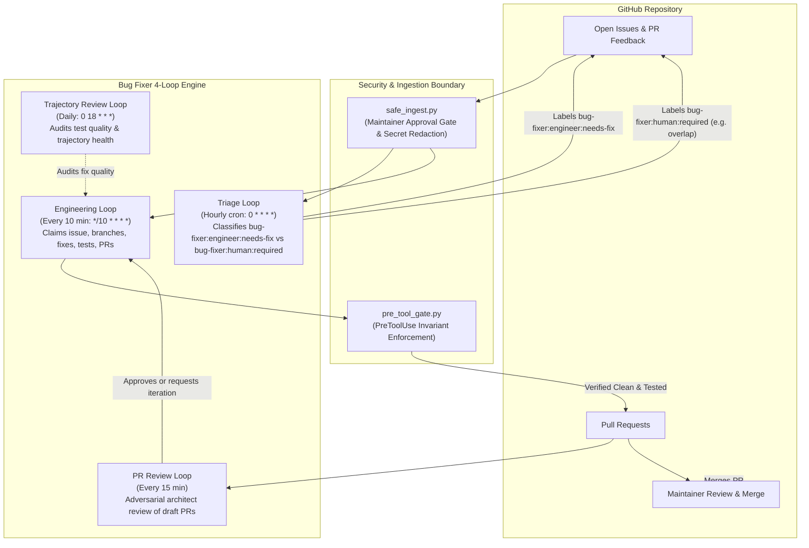

# bug-fixer-loop


Autonomous bug fixer loop plugin for Google Antigravity (AGY). It provides a 3-loop background agent system that autonomously triages, fixes, tests, and opens pull requests for small bugs and TODOs in a target repository while human engineers focus on major feature work and architectural PRs.

---

## Overview

Modern software development often suffers from an accumulation of small bugs, DX papercuts, and un-ignored test cases that distract maintainers from core product development. `bug-fixer-loop` operates as a trusted, guard-railed junior engineer:

- **Runs in background sidecars** on bounded cron schedules.
- **Respects human maintainer PR priority** via an active-PR exclusion zone.
- **Guarantees security & boundary defense** through PreToolUse hooks, safe ingestion filters, and mandatory test passes.
- **Never auto-merges**: All changes are delivered as clean, atomic Pull Requests for human review.

---

## Getting Started

### 1. Install Daemon
```bash
./scripts/install.sh
```
Deploys the bug-fixer daemon to `~/.gemini/config/plugins/bug-fixer-daemon/` and enables it via `agy plugin enable bug-fixer-daemon`.

### 2. Enroll Repository
```bash
./scripts/enroll.sh -r <owner/repo> -d <repo-dir>
```
Creates a per-repo sidecar, sets up configuration and state directories under `~/.gemini/config/plugins/bug-fixer-daemon/sidecars/<owner--repo>/`, and registers the shared workspace plugin in `<repo-dir>/.agents/plugins.json`.

### 3. Pause / Resume
```bash
agy plugin disable bug-fixer-daemon   # pause daemon
agy plugin enable bug-fixer-daemon    # resume daemon
```

### 4. Unenroll Repository
```bash
./scripts/unenroll.sh -r <owner/repo> -d <repo-dir>
```
Safely removes the enrolled repository's sidecar and removes the plugin registration from `.agents/plugins.json`.


---

## Directory Structure

The plugin uses a split-daemon architecture separating global scheduler concerns from workspace execution:

```
bug-fixer-loop-plugin/ (Source Repository)
├── daemon/
│   ├── plugin.json                               ← Daemon plugin manifest
│   ├── scripts/
│   │   └── tick.py                              ← Minimal heartbeat launcher
│   └── workspace-plugin/
│       └── bug-fixer/                            ← Workspace plugin bundle
│           ├── plugin.json                       ← Workspace plugin manifest
│           ├── hooks.json                        ← PreToolUse security hooks
│           ├── rules/                            ← Agent rules (AGENTS.md, etc.)
│           ├── skills/                           ← Agent skill definitions
│           ├── agents/                           ← Agent profiles (leak-auditor.md)
│           └── scripts/                          ← Dispatchers, gates, and APIs
└── scripts/
    ├── install.sh                                ← Deploys daemon to ~/.gemini/config/plugins/
    ├── enroll.sh                                 ← Enrolls a repository into the daemon
    ├── unenroll.sh                               ← Unenrolls a repository from the daemon
    └── uninstall.sh                              ← Uninstalls the daemon and cleans global state

~/.gemini/config/plugins/bug-fixer-daemon/ (Installed Daemon)
├── plugin.json
├── scripts/tick.py
├── sidecars/                                     ← Per-repo sidecar registry
│   └── <owner--repo>/
│       ├── sidecar.json                          ← 5-minute cron sidecar manifest
│       ├── config.json                           ← Target repository configuration
│       └── state/                                ← Claims, locks, dispatches, and logs
└── workspace-plugin/bug-fixer/                   ← Shared workspace plugin bundle

<enrolled-repo>/ (Consumer Repository)
└── .agents/
    └── plugins.json                              ← Loads workspace-plugin for the repo
```

---

## Architecture

The plugin implements a deterministic 3-loop engineering cycle:



---

## The 4 Loops

### 1. Triage Loop (`bug-fixer-triage-loop`)
- **Schedule:** Hourly (`0 * * * *`)
- **Execution Role:** Evaluates newly created or unclassified issues.
- **Responsibilities:**
  - Safely reads open issues via `safe_ingest.py`.
  - Checks for exclusion labels (`hardware-required`, `P1-blocker`, etc.).
  - Cross-references the maintainer's open PR file lists to exclude any issue touching overlapping modules.
  - Labels candidates as `bug-fixer:engineer:needs-fix` (bounded, single-module bugs with clear criteria) or `bug-fixer:human:required` (architectural, multi-module, or ambiguous issues).

### 2. Engineering Loop (`bug-fixer-engineering-loop`)
- **Schedule:** Every 2 hours (`30 */2 * * *`)
- **Execution Role:** Implements surgical fixes and delivers pull requests.
- **Responsibilities:**
  - Enforces PR concurrency caps (`max_concurrent_prs`).
  - Prioritizes remediating feedback on existing agent PRs before picking new work.
  - Claims highest-priority `bug-fixer:engineer:needs-fix` issue from `origin/main` in an ephemeral worktree.
  - Implements the fix and executes the mandatory `test_command` (e.g. `pio test -e native`).
  - Audits staged files for leaks with `pre_tool_gate.py --scan-only`.
  - Opens an atomic PR titled `[BugFixer] Resolves #<number>` containing test output.

### 3. PR Review Loop (`bug-fixer-pr-review-loop`)
- **Schedule:** Every 15 minutes
- **Execution Role:** Adversarial architect review of bug-fixer draft PRs.
- **Responsibilities:**
  - Polls for un-reviewed draft PRs with the `bug-fixer` label.
  - Spawns an Architect review conversation for each eligible draft.
  - Tracks review rounds and escalates to `bug-fixer:human:needs-intervention` after max rounds.

### 4. Trajectory Review Loop (`bug-fixer-trajectory-loop`)
- **Schedule:** Daily (`0 18 * * *`)
- **Execution Role:** Audits quality trends and agent trajectory logs.
- **Responsibilities:**
  - Audits test suite quality to ensure assertions test real behavior rather than tautologies.
  - Validates that leak audit receipts were consistently stamped.
  - Flags repeated test escalation patterns to prevent wasted agent cycles.

---

## Security Model

The security architecture provides three layers of defense against prompt injection, model drift, and unauthorized mutations:

1. **PreToolUse Hook Gate (`pre_tool_gate.py`)**:
   - **Structural command analysis:** Shell commands are parsed (`shell_analysis.py`) into individual commands, words, redirections, heredocs and substitutions, and each command is judged by what it executes. Wrappers (`bash -c`, `eval`, `$(...)`, `env -S`, `xargs`, `find -exec`, `git rebase --exec`, unmodelled runners such as `flock`/`tmux`/`ssh`) are analyzed recursively; anything assembled at runtime that would reach GitHub or a protected file is refused.
   - **Specification Immutability & Protected Files:** Denies writes, deletes, moves and inline-code references (`python -c "open(...)"`) targeting the specification, `protected_files`, the workspace `config.json` / `injection_cache.json` and scanner ignore files.
   - **Host Script Self-Defense:** Blocks autonomous edits to the gate, ingestion, egress-proxy, scanner and parser scripts.
   - **Forbidden Command Interception:** Blocks merges (`gh pr merge`, REST/GraphQL merge endpoints, pushes to `main`/`master`), self-approval, issue reopening, raw GitHub reads (`gh issue/pr list|view|status`, `gh search`, `gh api` reads of issues/PRs/comments), gh aliases/extensions, and repository/account configuration changes.
   - **Fake Approval Injection Defense:** Blocks posting approval text (`approved`, `/approve`, `LGTM`) from literal bodies, files and stdin.
   - **URL Fetch Gate (`github_url_gate.py`):** Redirects GitHub issue/PR page fetches to `safe_ingest.py` and blocks fetching any URL whose raw or percent-decoded form contains a leak-pattern match (a fetched URL is itself an outbound request).
   - **Egress Leak Gate:** Scans outbound GitHub content (bodies, titles, fields, `@file`/`--input`/gist/release files, stdin) and network tools (`curl`, `scp`, `nc`, …) against built-in plus configured leak patterns; content the gate cannot see at check time is refused.

2. **Deterministic Safe Ingestion (`safe_ingest.py`)**:
   - **Maintainer Approval Gate:** External issues and PRs require explicit maintainer approval before un-redacted titles, bodies, and comments are admitted into model context.
   - **TOCTOU Protection:** Compares timestamps (`createdAt`, `lastEditedAt`, `pushedDate`) against the approval timestamp to detect post-approval edits and force-pushes.
   - **Secret Redaction:** Free-text fields are sanitized against configurable `leak_patterns`.

3. **Git Hooks & Cryptographic Receipts**:
   - Staged tree SHA receipts (`.git/leak_audit_receipt.json`) are stamped by the `leak-auditor` agent and verified before push.
   - **No Auto-Merge Policy:** Autonomous agents are technically blocked from merging. Merging remains strictly a human action.

---

## Consumer Hook Integration

Consumer projects can differentiate between autonomous bug-fixer sessions and interactive human sessions in their PreToolUse hooks using `scripts/bugfixer_api.py`:

```python
from bugfixer_api import BugFixer

ctx = BugFixer.get_session_context(payload.get("conversationId", ""))

if ctx.is_autonomous:
    # Autonomous mode — no human to approve exceptions
    result = {"decision": "deny", "reason": f"Blocked in autonomous mode ({ctx.session_type})"}
else:
    # Interactive mode — let the human decide
    result = {"decision": "force_ask"}
```

The `SessionContext` also provides `session_type`, `issue_number`, `pr_number`, `worktree_path`, `target_repo`, and the full plugin `config`.

See [Consumer Hook API](docs/plugin-architecture.md#consumer-hook-api-bugfixer_apipy) in the architecture guide for full details.

---

## Installation

The plugin uses a two-step installation pattern:
1. Run `scripts/install.sh` to install the daemon plugin to `~/.gemini/config/plugins/bug-fixer-daemon/`.
2. Run `scripts/enroll.sh` to enroll target repositories into the daemon's sidecar scheduler and register the workspace plugin.

### Installation Steps

> **Note:** Run `install.sh` from a normal terminal, not from inside an
> Antigravity agent session. The integrity monitor will revert security
> script updates made during a live session.

```bash
# 1. Install daemon plugin components
./scripts/install.sh

# 2. Enroll a target repository (sets up sidecar, config, state, and registers plugin)
./scripts/enroll.sh -r matthewmcneill/esp32-app-foundation -d /Users/mcneillm/Documents/Projects/esp32-app-foundation

# 3. Enable the daemon plugin (enabled automatically if agy CLI is present)
agy plugin enable bug-fixer-daemon
```

### Install Script Options

```
Usage: ./scripts/install.sh

Deploys the daemon plugin from daemon/ to ~/.gemini/config/plugins/bug-fixer-daemon/
using rsync (preserving existing sidecars/ data), and enables the plugin via agy.
```

### Enrollment Script Options

```
Usage: ./scripts/enroll.sh -r <owner/repo> -d <repo-dir> [--migrate-state]

Options:
  -r <owner/repo>       Target GitHub repository (required)
  -d <repo-dir>         Local checkout path of target repository (required)
  --migrate-state       Migrate existing state from .agents/plugins/bug-fixer-loop-workspace
```

### Unenrollment Script Options

To remove an enrolled repository without uninstalling the daemon:

```bash
./scripts/unenroll.sh -r matthewmcneill/esp32-app-foundation -d /Users/mcneillm/Documents/Projects/esp32-app-foundation
```

```
Usage: ./scripts/unenroll.sh -r <owner/repo> [-d <repo-dir>]

Checks for active in-flight claims, deletes the repo sidecar directory from the daemon,
and removes the workspace-plugin entry from the consumer repo's .agents/plugins.json.
```

---

## Configuration Reference

Configuration is managed per enrolled repository at `~/.gemini/config/plugins/bug-fixer-daemon/sidecars/<owner--repo>/config.json` (generated during enrollment):

| Field | Type | Description | Default |
|-------|------|-------------|---------|
| `$schema` | `string` | Configuration schema version identifier | `"bug-fixer-loop-config-v1"` |
| `target_repo` | `string` | Target repository slug (`owner/repo`) | `""` |
| `repo_dir` | `string` | Local checkout path of target repository | `""` |
| `maintainer` | `string` | Primary trusted GitHub maintainer username | `""` |
| `trusted_users` | `array[string]` | Additional trusted GitHub logins allowed to approve issues | `[]` |
| `spec_file_path` | `string` | Project specification file protected from agent mutation | `"docs/design_specification.md"` |
| `protected_files` | `array[string]` | List of files that autonomous agents must never modify | `["docs/design_specification.md"]` |
| `leak_patterns` | `array[string]` | Regular expressions checked for secrets and tokens | `["ya29\\.[A-Za-z0-9_-]+", "AKIA[0-9A-Z]{16}", "-----BEGIN (RSA \|EC )?PRIVATE KEY-----"]` |
| `max_concurrent_prs` | `integer` | Maximum concurrent open agent PRs allowed | `1` |
| `exclusion_labels` | `array[string]` | Issue labels that immediately disqualify from auto-fix | `["bug-fixer:human:required", "P1-blocker", "hardware-required"]` |
| `auto_fixable_labels` | `array[string]` | Labels identifying issues triaged for autonomous fixing | `["bug-fixer:engineer:needs-fix"]` |
| `required_labels` | `array[string]` | Standard label taxonomy maintained in target repository | `["bug-fixer:engineer:needs-fix", "bug-fixer:human:required", "bug-fixer:human:needs-approach-review", "bug-fixer:human:project-candidate", "bug-fixer:human:input-needed", "bug-fixer:engineer:in-progress", "bug-fixer:system:pr", "bug-fixer:system:health", "bug-fixer:human:spec-change-request"]` |
| `auto_fixable_max_priority` | `string` | Priority ceiling for automated fixes | `"P3-docs-dx"` |
| `test_command` | `string` | Test command that must pass before any PR is opened | `"pio test -e native"` |
| `lint_command` | `string` | Optional linter command to run before PR | `""` |
| `pr_prefix` | `string` | Title prefix for created pull requests | `"[BugFixer]"` |
| `branch_prefix` | `string` | Git branch name prefix for fix branches | `"fix"` |
| `triage_cron` | `string` | Cron schedule expression for triage sidecar | `"0 * * * *"` |
| `engineering_cron` | `string` | Cron schedule expression for engineering fixer sidecar | `"30 */2 * * *"` |
| `trajectory_review_cron` | `string` | Cron schedule expression for review sidecar | `"0 18 * * *"` |

---

## Safety Rules Summary

Autonomous agents running this plugin must strictly adhere to the 12 invariants defined in `rules/AGENTS.md`:

1. **Never Auto-Merge:** `gh pr merge` and `gh stack merge` are forbidden.
2. **Specification Immutability:** Never modify or delete `spec_file_path`.
3. **Protected Files:** Never modify files listed in `protected_files`.
4. **Active PR Exclusion Zone:** Skip any issue whose fix overlaps files in the maintainer's open PRs.
5. **Safe GitHub Reads:** All issue, PR, and comment reads must route through `safe_ingest.py`.
6. **Mandatory Testing:** The configured `test_command` must pass with full output included in the PR description.
7. **PR Concurrency Cap:** Never open a PR if open agent PR count >= `max_concurrent_prs`.
8. **No Self-Approval:** Never comment `approved` or execute `gh pr review --approve`.
9. **No Scope Invention:** Do not create tasks, projects, or refactor beyond the claimed issue.
10. **No Issue Reopening:** Never run `gh issue reopen`.
11. **Atomic PRs:** Each PR addresses exactly one issue and includes `Resolves #<num>` in its title.
12. **Main-Only Branching:** Always branch from `origin/main` in dedicated worktree.

---

## Concurrency & Worktree Isolation

To prevent conflicts between autonomous background agent loops and human developers:

- **Active PR Exclusion Zone:** Triage actively inspects the maintainer's open PRs via GitHub API. If an issue requires modifying files touched by an active maintainer PR, the issue is skipped or labeled `bug-fixer:human:required`.
- **Ephemeral Worktree Operation:** The engineering dispatcher creates an ephemeral git worktree for each agent session (`<repo_root>/worktrees/issue-<number>`), ensuring complete isolation for concurrent agent sessions and protecting the maintainer's active working tree.

---

## Enable & Disable

Enable or disable the daemon at any time using standard Antigravity CLI commands:

```bash
# Enable the plugin
agy plugin enable bug-fixer-daemon

# Disable the plugin (pauses all sidecars and hooks)
agy plugin disable bug-fixer-daemon
```

---

## Uninstallation

To remove the bug-fixer daemon plugin and associated artifacts:

```bash
# Recommended: Unenroll repositories first
./scripts/unenroll.sh -r <owner/repo> -d <repo-dir>

# Uninstall the daemon
./scripts/uninstall.sh

# If enrolled sidecars remain and you want to remove everything:
./scripts/uninstall.sh --force
```


---

## Development & Testing

Run the test suite using Python's standard `unittest` framework:

```bash
# Discover and run all unit tests
python3 -m unittest discover -s tests -v

# Run safe ingest tests
python3 -m unittest tests/test_safe_ingest.py -v

# Run pre-tool gate tests
python3 -m unittest tests/test_pre_tool_gate.py -v
```
