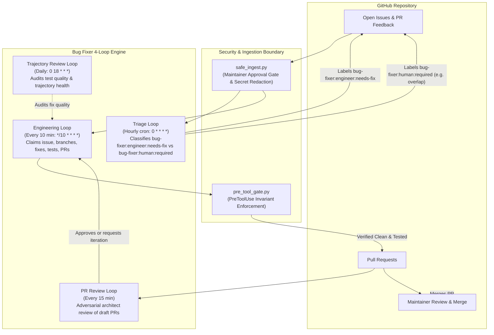

# bug-fixer-loop


Autonomous bug fixer loop plugin for Google Antigravity (AGY). It provides a 3-loop background agent system that autonomously triages, fixes, tests, and opens pull requests for small bugs and TODOs in a target repository while human engineers focus on major feature work and architectural PRs.

---

## Overview

Modern software development often suffers from an accumulation of small bugs, DX papercuts, and un-ignored test cases that distract maintainers from core product development. `bug-fixer-loop` operates as a trusted, guard-railed junior engineer:

- **Runs in background sidecars** on bounded cron schedules.
- **Respects human maintainer PR priority** via an active-PR exclusion zone.
- **Guarantees security & boundary defense** through PreToolUse hooks, safe ingestion filters, and mandatory test passes.
- **Never auto-merges**: All changes are delivered as clean, atomic Pull Requests for human review.

---

## Getting Started

### 1. Install
```bash
./scripts/install.sh
```
The plugin ships **disabled** by default. No sidecars will run until you configure and enable it.

### 2. Configure
```bash
./scripts/configure.sh --repo <owner/repo> --repo-dir <path>
```
The wizard validates connectivity, creates labels, and optionally sets up an isolated worktree.

### 3. Enable
```bash
agy plugin enable bug-fixer-loop
```
The 3 background sidecars will now run on their configured schedules.

### 4. Pause / Resume
```bash
agy plugin disable bug-fixer-loop   # pause
agy plugin enable bug-fixer-loop    # resume
```

---

## Architecture

The plugin implements a deterministic 3-loop engineering cycle:



---

## The 4 Loops

### 1. Triage Loop (`bug-fixer-triage-loop`)
- **Schedule:** Hourly (`0 * * * *`)
- **Execution Role:** Evaluates newly created or unclassified issues.
- **Responsibilities:**
  - Safely reads open issues via `safe_ingest.py`.
  - Checks for exclusion labels (`hardware-required`, `P1-blocker`, etc.).
  - Cross-references the maintainer's open PR file lists to exclude any issue touching overlapping modules.
  - Labels candidates as `bug-fixer:engineer:needs-fix` (bounded, single-module bugs with clear criteria) or `bug-fixer:human:required` (architectural, multi-module, or ambiguous issues).

### 2. Engineering Loop (`bug-fixer-engineering-loop`)
- **Schedule:** Every 2 hours (`30 */2 * * *`)
- **Execution Role:** Implements surgical fixes and delivers pull requests.
- **Responsibilities:**
  - Enforces PR concurrency caps (`max_concurrent_prs`).
  - Prioritizes remediating feedback on existing agent PRs before picking new work.
  - Claims highest-priority `bug-fixer:engineer:needs-fix` issue from `origin/main` in a dedicated worktree.
  - Implements the fix and executes the mandatory `test_command` (e.g. `pio test -e native`).
  - Audits staged files for leaks with `pre_tool_gate.py --scan-only`.
  - Opens an atomic PR titled `[BugFixer] Resolves #<number>` containing test output.

### 3. PR Review Loop (`bug-fixer-pr-review-loop`)
- **Schedule:** Every 15 minutes
- **Execution Role:** Adversarial architect review of bug-fixer draft PRs.
- **Responsibilities:**
  - Polls for un-reviewed draft PRs with the `bug-fixer` label.
  - Spawns an Architect review conversation for each eligible draft.
  - Tracks review rounds and escalates to `bug-fixer:human:needs-intervention` after max rounds.

### 4. Trajectory Review Loop (`bug-fixer-trajectory-loop`)
- **Schedule:** Daily (`0 18 * * *`)
- **Execution Role:** Audits quality trends and agent trajectory logs.
- **Responsibilities:**
  - Audits test suite quality to ensure assertions test real behavior rather than tautologies.
  - Validates that leak audit receipts were consistently stamped.
  - Flags repeated test escalation patterns to prevent wasted agent cycles.

---

## Security Model

The security architecture provides three layers of defense against prompt injection, model drift, and unauthorized mutations:

1. **PreToolUse Hook Gate (`pre_tool_gate.py`)**:
   - **Specification Immutability:** Denies all writes and shell mutations (`sed -i`, `>`, `rm`, `cp`) targeting the project specification (`docs/design_specification.md`).
   - **Protected Files:** Prohibits modification of sensitive human artifacts listed in `protected_files`.
   - **Host Script Self-Defense:** Blocks autonomous edits to `pre_tool_gate.py` and `safe_ingest.py`.
   - **Forbidden Command Interception:** Blocks `gh pr merge`, `gh stack merge`, `gh pr review --approve`, `gh issue reopen`, and raw `gh issue/pr list|view`.
   - **Fake Approval Injection Defense:** Blocks posting approval commands (`approved`, `/approve`).

2. **Deterministic Safe Ingestion (`safe_ingest.py`)**:
   - **Maintainer Approval Gate:** External issues and PRs require explicit maintainer approval before un-redacted titles, bodies, and comments are admitted into model context.
   - **TOCTOU Protection:** Compares timestamps (`createdAt`, `lastEditedAt`, `pushedDate`) against the approval timestamp to detect post-approval edits and force-pushes.
   - **Secret Redaction:** Free-text fields are sanitized against configurable `leak_patterns`.

3. **Git Hooks & Cryptographic Receipts**:
   - Staged tree SHA receipts (`.git/leak_audit_receipt.json`) are stamped by the `leak-auditor` agent and verified before push.
   - **No Auto-Merge Policy:** Autonomous agents are technically blocked from merging. Merging remains strictly a human action.

---

## Installation

The plugin includes an installation script (`scripts/install.sh`) to link skills, agents, rules, and sidecars, followed by an interactive configuration wizard (`scripts/configure.sh`) that validates connectivity, creates GitHub labels, sets up a worktree, and configures the plugin.

The plugin ships **disabled** by default. After installation and configuration, enable the plugin using `agy plugin enable bug-fixer-loop`.

### Installation Steps

```bash
# 1. Install plugin components
./scripts/install.sh \
  --repo matthewmcneill/esp32-app-foundation \
  --repo-dir /Users/mcneillm/Documents/Projects/esp32-app-foundation \
  --maintainer matthewmcneill

# 2. Run the configuration wizard (validates connectivity, labels, worktree)
./scripts/configure.sh --repo matthewmcneill/esp32-app-foundation --repo-dir /Users/mcneillm/Documents/Projects/esp32-app-foundation

# 3. Enable the plugin
agy plugin enable bug-fixer-loop
```

### Install Flags & Options

```
Usage: ./scripts/install.sh [OPTIONS]

Options:
  -r, --repo <owner/repo>       Target GitHub repository (required)
  -d, --repo-dir <path>         Local checkout path (defaults to ~/projects/<repo_name>)
  -m, --maintainer <login>      Trusted maintainer (defaults to gh api user -q .login)
  --skills-only                 Install skills, agents, and scripts without configuring sidecars
  -h, --help                    Show this help message
```

### Configuration Wizard Flags & Options

```
Usage: ./scripts/configure.sh [OPTIONS]

Options:
  -r, --repo <owner/repo>       Target GitHub repository (e.g. owner/repo)
  -d, --repo-dir <path>         Local checkout path of target repository
  -m, --maintainer <login>      Trusted maintainer GitHub login
  --spec-file <path>            Path to design specification file (default: docs/design_specification.md)
  --test-command <cmd>          Test command to run (default: pio test -e native)
  --lint-command <cmd>          Lint command to run (optional)
  --worktree-path <path>        Path for isolated git worktree
  --no-worktree                 Skip creating git worktree
  -y, --yes                     Non-interactive mode (accept defaults)
  -h, --help                    Show this help message
```

---

## Configuration Reference

Configuration is managed in `config.json` at the root of the plugin or target repository:

| Field | Type | Description | Default |
|-------|------|-------------|---------|
| `$schema` | `string` | Configuration schema version identifier | `"bug-fixer-loop-config-v1"` |
| `target_repo` | `string` | Target repository slug (`owner/repo`) | `""` |
| `repo_dir` | `string` | Local checkout path of target repository | `""` |
| `worktree_path` | `string` | Isolated git worktree directory for autonomous agent execution | `""` |
| `maintainer` | `string` | Primary trusted GitHub maintainer username | `""` |
| `trusted_users` | `array[string]` | Additional trusted GitHub logins allowed to approve issues | `[]` |
| `spec_file_path` | `string` | Project specification file protected from agent mutation | `"docs/design_specification.md"` |
| `protected_files` | `array[string]` | List of files that autonomous agents must never modify | `["docs/design_specification.md"]` |
| `leak_patterns` | `array[string]` | Regular expressions checked for secrets and tokens | `["ya29\\.[A-Za-z0-9_-]+", "AKIA[0-9A-Z]{16}", "-----BEGIN (RSA \|EC )?PRIVATE KEY-----"]` |
| `max_concurrent_prs` | `integer` | Maximum concurrent open agent PRs allowed | `1` |
| `exclusion_labels` | `array[string]` | Issue labels that immediately disqualify from auto-fix | `["bug-fixer:human:required", "P1-blocker", "hardware-required"]` |
| `auto_fixable_labels` | `array[string]` | Labels identifying issues triaged for autonomous fixing | `["bug-fixer:engineer:needs-fix"]` |
| `required_labels` | `array[string]` | Standard label taxonomy maintained in target repository | `["bug-fixer:engineer:needs-fix", "bug-fixer:human:required", "bug-fixer:human:needs-approach-review", "bug-fixer:human:project-candidate", "bug-fixer:human:input-needed", "bug-fixer:engineer:in-progress", "bug-fixer:engineer:pr", "bug-fixer:system:health", "bug-fixer:human:spec-change-request"]` |
| `auto_fixable_max_priority` | `string` | Priority ceiling for automated fixes | `"P3-docs-dx"` |
| `test_command` | `string` | Test command that must pass before any PR is opened | `"pio test -e native"` |
| `lint_command` | `string` | Optional linter command to run before PR | `""` |
| `pr_prefix` | `string` | Title prefix for created pull requests | `"[BugFixer]"` |
| `branch_prefix` | `string` | Git branch name prefix for fix branches | `"fix"` |
| `triage_cron` | `string` | Cron schedule expression for triage sidecar | `"0 * * * *"` |
| `engineering_cron` | `string` | Cron schedule expression for engineering fixer sidecar | `"30 */2 * * *"` |
| `trajectory_review_cron` | `string` | Cron schedule expression for review sidecar | `"0 18 * * *"` |

---

## Safety Rules Summary

Autonomous agents running this plugin must strictly adhere to the 12 invariants defined in `rules/AGENTS.md`:

1. **Never Auto-Merge:** `gh pr merge` and `gh stack merge` are forbidden.
2. **Specification Immutability:** Never modify or delete `spec_file_path`.
3. **Protected Files:** Never modify files listed in `protected_files`.
4. **Active PR Exclusion Zone:** Skip any issue whose fix overlaps files in the maintainer's open PRs.
5. **Safe GitHub Reads:** All issue, PR, and comment reads must route through `safe_ingest.py`.
6. **Mandatory Testing:** The configured `test_command` must pass with full output included in the PR description.
7. **PR Concurrency Cap:** Never open a PR if open agent PR count >= `max_concurrent_prs`.
8. **No Self-Approval:** Never comment `approved` or execute `gh pr review --approve`.
9. **No Scope Invention:** Do not create tasks, projects, or refactor beyond the claimed issue.
10. **No Issue Reopening:** Never run `gh issue reopen`.
11. **Atomic PRs:** Each PR addresses exactly one issue and includes `Resolves #<num>` in its title.
12. **Main-Only Branching:** Always branch from `origin/main` in dedicated worktree.

---

## Concurrency & Worktree Isolation

To prevent conflicts between autonomous background agent loops and human developers:

- **Active PR Exclusion Zone:** Triage actively inspects the maintainer's open PRs via GitHub API. If an issue requires modifying files touched by an active maintainer PR, the issue is skipped or labeled `bug-fixer:human:required`.
- **Dedicated Worktree Operation:** The engineering agent operates within a dedicated git worktree, ensuring the maintainer's active working tree, index, and untracked files are untouched.

---

## Enable & Disable

Enable or disable the plugin at any time using standard Antigravity CLI commands:

```bash
# Enable the plugin
agy plugin enable bug-fixer-loop

# Disable the plugin (pauses all sidecars and hooks)
agy plugin disable bug-fixer-loop
```

---

## Uninstallation

To remove all deployed skills, sidecars, hooks, and agents while preserving `config.json`:

```bash
./scripts/uninstall.sh \
  --repo matthewmcneill/esp32-app-foundation \
  --repo-dir /Users/mcneillm/Documents/Projects/esp32-app-foundation
```

---

## Development & Testing

Run the test suite using Python's standard `unittest` framework:

```bash
# Discover and run all unit tests
python3 -m unittest discover -s tests -v

# Run safe ingest tests
python3 -m unittest tests/test_safe_ingest.py -v

# Run pre-tool gate tests
python3 -m unittest tests/test_pre_tool_gate.py -v
```
