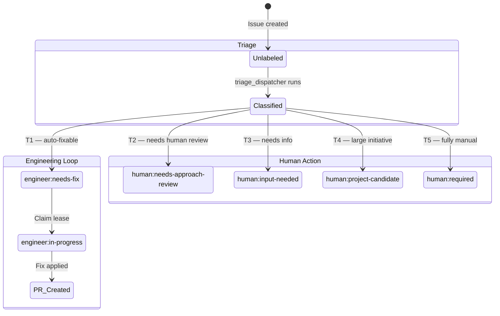
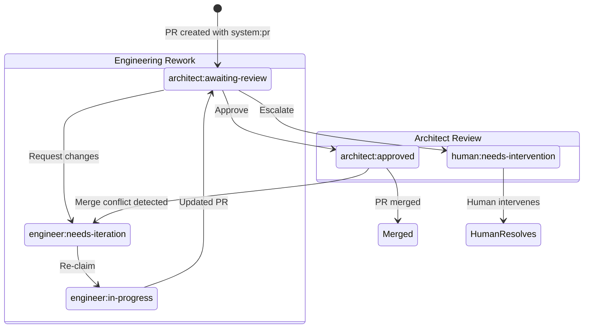
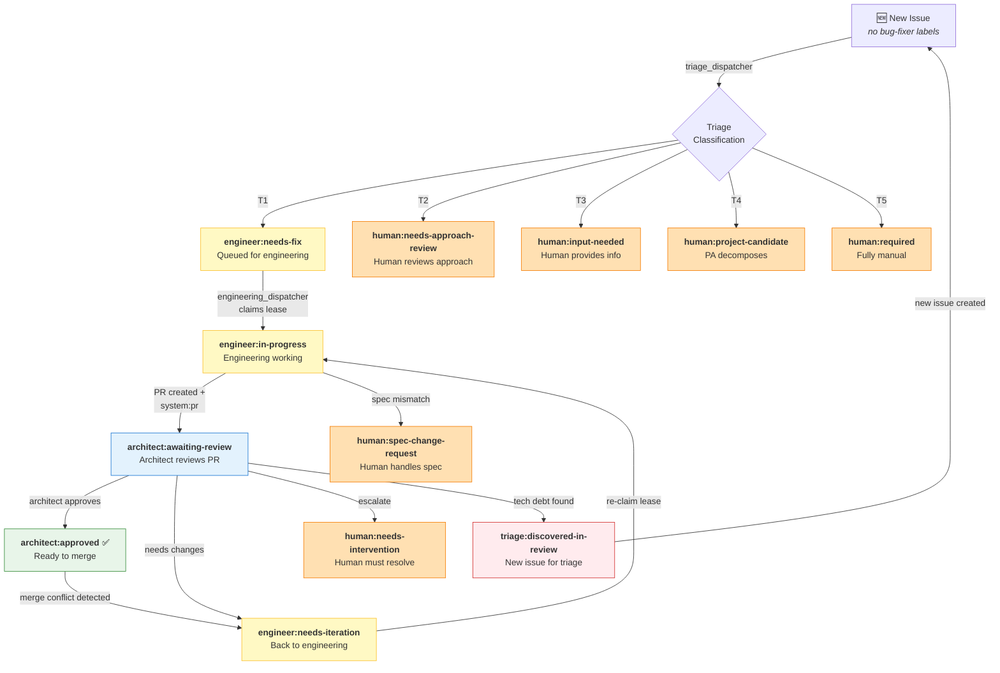

# Bug-Fixer Label Taxonomy & State Machine

> Canonical reference for the GitHub label namespace, routing model, and issue/PR lifecycle state machine used by the bug-fixer system.

---

## Table of Contents

- [Design Principles](#design-principles)
- [Namespace Schema](#namespace-schema)
- [Actor Segments](#actor-segments)
- [Canonical Label Registry](#canonical-label-registry)
- [State Machine](#state-machine)
  - [Issue Lifecycle](#issue-lifecycle)
  - [PR Review Lifecycle](#pr-review-lifecycle)
  - [Full System Flow](#full-system-flow)
- [Dispatcher Routing Table](#dispatcher-routing-table)
- [Labels NOT Owned by Bug-Fixer](#labels-not-owned-by-bug-fixer)
- [Dashboard Quick Filters](#dashboard-quick-filters)
- [Adding New Labels](#adding-new-labels)

---

## Design Principles

1. **Every label is a routing signal.** Each label answers the question: *"Whose court is the ball in?"* — which actor currently owns the action.

2. **Consumer-oriented naming.** The middle segment identifies the **consumer** (who should act), not the producer (who set it). When the architect sets `bug-fixer:engineer:needs-iteration`, the label says "this is going back to engineering."

3. **Action-oriented vocabulary.** Labels describe what the consumer should *do* — `needs-fix`, `needs-iteration`, `awaiting-review` — not what triage *thought* about the issue.

4. **Metadata labels have no actor.** Labels that don't route to anyone (`complexity:*`, `batch:*`) use a descriptive segment instead of an actor segment.

5. **Bug-fixer only owns `bug-fixer:*` labels.** Priority labels, effort heuristics, security quarantine, and target-repo exclusion labels are never prefixed — they belong to the broader ecosystem.

---

## Namespace Schema

```
bug-fixer:<segment>:<name>
         │          │
         │          └── action/state within that segment
         └── actor who owns the action, or metadata category
```

### Actor Segments

| Segment | Actor | Description |
|---|---|---|
| `engineer` | Engineering dispatcher (automated) | The automated fix loop — claims issues, creates PRs, iterates |
| `architect` | Architect dispatcher (automated) | The automated review loop — reviews PRs, approves or requests iteration |
| `human` | Human operator (manual) | Requires human attention — approach review, input, escalation |
| `triage` | Triage dispatcher (automated) | Needs (re-)classification — e.g., issues discovered during review |
| `system` | System monitoring | System-level alerts and diagnostics |

### Metadata Segments (no actor)

| Segment | Description |
|---|---|
| `complexity` | Model routing tier — determines which LLM tier handles the issue |
| `batch` | Bundle affinity — groups related PRs for coordinated submission |

---

## Canonical Label Registry

### Routing Labels (actor-owned)

| Label | Actor | Purpose | Set By | Consumed By |
|---|---|---|---|---|
| `bug-fixer:engineer:needs-fix` | Engineer | Issue queued for automated fix | Triage dispatcher | Engineering dispatcher |
| `bug-fixer:engineer:in-progress` | Engineer | Engineering has claimed this issue (lease) | Engineering dispatcher | Engineering dispatcher (re-entry guard) |
| `bug-fixer:engineer:needs-iteration` | Engineer | PR needs engineering rework after review | Architect dispatcher | Engineering dispatcher |
| `bug-fixer:system:pr` | System | Marks a PR as bug-fixer-created | Engineering agent | Architect dispatcher, trajectory dispatcher |
| `bug-fixer:architect:awaiting-review` | Architect | PR ready for architect review | Engineering agent | Architect dispatcher |
| `bug-fixer:architect:approved` | Architect | Architect approved the PR (terminal unless conflict) | Architect agent | Architect dispatcher (conflict monitor) |
| `bug-fixer:human:required` | Human | Issue requires full human handling (T5) | Triage dispatcher | Human operator |
| `bug-fixer:human:needs-approach-review` | Human | Approach needs human review before fix (T2) | Triage dispatcher | Human operator |
| `bug-fixer:human:input-needed` | Human | Issue needs more information from human (T3) | Triage dispatcher | Human operator |
| `bug-fixer:human:project-candidate` | Human | Large initiative, needs PA decomposition (T4) | Triage dispatcher | Human operator / PA |
| `bug-fixer:human:needs-intervention` | Human | Architect escalated — needs human resolution | Architect dispatcher | Human operator |
| `bug-fixer:human:spec-change-request` | Human | Spec mismatch detected during fix | Engineering agent | Human operator |
| `bug-fixer:triage:discovered-in-review` | Triage | New issue discovered during architect review | Architect agent | Triage dispatcher |
| `bug-fixer:system:health` | System | System health alert / diagnostic issue | Trajectory dispatcher | Human operator |

### Metadata Labels (no actor)

| Label | Purpose | Set By |
|---|---|---|
| `bug-fixer:complexity:mechanical` | Model tier: rote/deterministic work | Triage agent |
| `bug-fixer:complexity:standard` | Model tier: standard engineering work | Triage agent |
| `bug-fixer:complexity:architect` | Model tier: needs architect-grade reasoning | Triage agent |
| `bug-fixer:batch:<slug>` | PR bundle affinity grouping | Engineering agent / triage agent |

---

## State Machine

### Issue Lifecycle



### PR Review Lifecycle



### Full System Flow



**Colour key:**
🟡 `engineer:*` — engineering loop |
🔵 `architect:*` — architect loop (`approved` is 🟢) |
🟠 `human:*` — human action required |
🔴 `triage:*` — needs classification |
🟣 `complexity:*` — model routing tier |
🪻 `system:*` — system alerts

---

## Dispatcher Routing Table

Each dispatcher queries specific labels as its **input** and applies labels as its **output**.

| Dispatcher | Input (queries for) | Output (applies) | Removes |
|---|---|---|---|
| `triage_dispatcher` | Issues with NO `bug-fixer:*` classification label | One of: `engineer:needs-fix`, `human:required`, `human:needs-approach-review`, `human:input-needed`, `human:project-candidate` + optionally `complexity:*` | — |
| `engineering_dispatcher` | Issues: `engineer:needs-fix` (not `engineer:in-progress`). PRs: `system:pr` + `engineer:needs-iteration` | `engineer:in-progress` (claim), `system:pr` (on PR), `architect:awaiting-review` (done), `batch:<slug>` | `engineer:in-progress` (release), `engineer:needs-iteration` (after re-claim) |
| `architect_dispatcher` | PRs: `system:pr` (not `architect:approved`, not `engineer:needs-iteration`) | One of: `architect:approved`, `engineer:needs-iteration`, `human:needs-intervention`. Optionally files new issue with `triage:discovered-in-review` | — |
| `trajectory_dispatcher` | Stale `engineer:in-progress`, repeated failures | `system:health` (alert issue), `human:required` (escalation) | `engineer:in-progress` (stale unclaim) |
| `liveness` | `architect:awaiting-review` (success check), `engineer:needs-iteration` (iteration check) | — (monitoring only) | `engineer:in-progress` (stale recovery) |

---

## Labels NOT Owned by Bug-Fixer

These labels exist on target repositories but are **not** prefixed with `bug-fixer:` — they belong to the broader ecosystem and are read (not written) by the bug-fixer system.

| Label(s) | Who Owns Them | How Bug-Fixer Uses Them |
|---|---|---|
| `security:prompt-injection` | Security operators | `safe_ingest.py` quarantines issues with this label |
| `priority:*`, `p0`–`p3`, `urgent`/`high`/`medium`/`low` | Human maintainers / GitHub Projects | `safe_ingest.py` sorts issues by priority |
| `hardware-required`, `P1-blocker` | Human engineers on target repos | `configure.sh` excludes these from auto-fix |
| `S`/`L`/`XL`-effort | Human engineers on target repos | `configure.sh` uses for effort heuristic classification |

---

## Dashboard Quick Filters

Use these GitHub label searches to build actionable views:

| View | Filter | Shows |
|---|---|---|
| **My action items** | `bug-fixer:human:` | Everything waiting for human attention |
| **Engineering queue** | `bug-fixer:engineer:needs-fix` | Issues ready for the automated fix loop |
| **Engineering active** | `bug-fixer:engineer:in-progress` | Issues currently being worked |
| **Awaiting review** | `bug-fixer:architect:awaiting-review` | PRs waiting for architect review |
| **Needs iteration** | `bug-fixer:engineer:needs-iteration` | PRs sent back for rework |
| **Approved PRs** | `bug-fixer:architect:approved` | PRs ready to merge |
| **System health** | `bug-fixer:system:health` | Diagnostic alerts |
| **All bug-fixer** | `bug-fixer:` | Everything in the bug-fixer system |

---

## Adding New Labels

When adding a new label to the bug-fixer system:

1. **Determine the consumer** — who should act on this label?
2. **Pick the actor segment** — `engineer`, `architect`, `human`, `triage`, `system`, or a metadata segment
3. **Name the action** — use action-oriented vocabulary (`needs-*`, `awaiting-*`, `in-*`)
4. **Add to this registry** — update the Canonical Label Registry table above
5. **Add to `config.json`** — add the label to `required_labels` so `configure.sh` provisions it
6. **Add to `configure.sh`** — add colour and description in `LABELS_META`
7. **Update dispatchers** — add queries/mutations in the relevant dispatcher
8. **Update skills** — reference the new label in relevant skill SKILL.md files

## Race Window & Label Transition Atomicity

When transitioning labels (e.g., removing `bug-fixer:architect:awaiting-review` and adding `bug-fixer:engineer:needs-iteration`), there is a brief window where the PR has neither label due to the lack of atomic multi-label operations in the GitHub API. 
The system mitigates this race window using dispatch-file guards in `DISPATCHES_DIR`. These dispatch files provide idempotency protection ensuring that dispatchers do not accidentally ignore or double-process a PR during this brief transition phase.
